<div align="center">

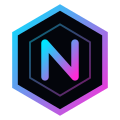

# NEXUS

**La veille tech en temps réel — sans compte, gratuite et open source.**

IA · apps et jeux rétro-ingéniérés · informatique · cybersécurité<br>
42 sources fiables, rafraîchies toutes les minutes, au même endroit.<br>
Et vos propres pages sur n'importe quel sujet : F1, foot, politique…

<br>

[](CHANGELOG.md)


<br>

[](https://render.com/deploy?repo=https://github.com/PedroGomesFR/nexus)

</div>

<br>

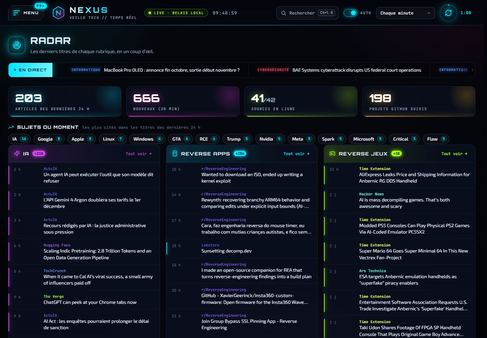

## Pourquoi NEXUS ?

Suivre l'actualité tech oblige à jongler entre des dizaines de sites, d'applications et de newsletters, souvent avec un compte à créer.
NEXUS rassemble tout sur une seule page :

- **Sans compte.** Pas d'inscription, pas d'e-mail. On ouvre la page, on lit.
- **Gratuit.** Pas d'abonnement, pas de publicité. Chaque article renvoie vers son site d'origine.
- **Open source.** Le code est lisible et réutilisable (licence MIT). Vous pouvez héberger votre propre NEXUS.
- **Des sources visibles.** Chaque article affiche sa source et son type : officiel, presse, recherche, expert ou communauté.
- **Vos données restent chez vous.** Favoris et réglages sont stockés dans votre navigateur. Aucun pisteur, aucune statistique de visite.

## Fonctionnalités

| | |
|---|---|
| 🛰️ **Radar** | Vue d'ensemble : derniers titres de chaque rubrique, bandeau « en direct », statistiques, **sujets du moment** (les noms les plus cités dans les titres des dernières 24 h) |
| 🔄 **Temps réel** | Rafraîchissement automatique de 30 s à 15 min, bouton manuel, badge sur le menu et les rubriques qui ont du nouveau |
| ⌨️ **Rechercher partout** | `Ctrl K` (ou la loupe) : articles de toutes les rubriques et favoris, projets GitHub, jeux, apps, modèles d'IA, pages et actions, au clavier |
| 🔔 **Alertes** | Des mots surveillés sur tout le site : chaque nouvel article qui en parle est signalé, étiqueté et rassemblé dans la page Alertes, avec notification du navigateur en option |
| 🔎 **Filtres** | Recherche, langue (FR / EN), période, type de source, vue cartes ou liste, **non lus seulement** |
| 👁️ **Lu / non lu** | Un article ouvert s'estompe ; « Non lus » masque ceux déjà lus, « Tout marquer comme lu » s'annule en un clic |
| 📲 **Application** | NEXUS s'installe sur l'écran d'accueil (Android, iPhone, ordinateur) et reste lisible hors ligne ; partage d'un article en un geste |
| 🏆 **Classement des IA** | Tous les modèles évalués par Artificial Analysis : index d'intelligence, de code et d'agents, prix d'entrée et de sortie, intelligence par dollar, contexte, taille (poids ouverts), date de sortie. Tri par colonne, filtres poids ouverts / propriétaires, capacités et créateur |
| 🎮 **Projets GitHub** | Catalogue des décompilations de jeux et des apps / API rétro-ingéniérées, triés par étoiles ou par activité |
| 🕹️ **Jouer** | 25 jeux rétro-ingéniérés : liens officiels pour jouer en ligne ou télécharger, ce qu'il faut fournir et comment les lancer |
| 🚀 **Utiliser** | 23 apps rétro-ingéniérées (pilotes, firmwares, clients libres : Gadgetbridge, OpenRGB, Asahi Linux, Wine…) : liens officiels, ce qu'il faut, comment les installer, filtres par domaine et par plateforme |
| 🗂️ **Pages perso** | Une page sur le sujet de votre choix, avec son icône et sa couleur : 13 modèles prêts à l'emploi (politique, F1, foot, voiture…) avec des médias vérifiés, des mots-clés suivis dans la presse via Google Actualités, et vos propres sites. Toute la page suit vos mots-clés : ses sites n'affichent que les articles qui en parlent |
| 🔖 **Favoris** | Conservés même quand l'article disparaît des flux |
| ➕ **Sources perso** | Ajoutez un site (son flux RSS est trouvé automatiquement), un flux RSS/Atom ou une recherche Hacker News |
| 🧹 **Catalogue à la carte** | Retirez les sources qui ne vous intéressent pas, rétablissez-les en un clic |
| 🌐 **Traduction** | Un clic pour lire un article anglais traduit en français |
| 💾 **Sauvegarde** | Export / import JSON de vos favoris et réglages pour changer d'appareil |
| 🎁 **Nouveautés** | Ce qui a changé, version par version. Une nouvelle version est annoncée à la visite suivante (notification et pastille dans le menu). Historique complet dans [CHANGELOG.md](CHANGELOG.md) |
| ✨ **Interface** | Thème néon, menu hamburger, transitions animées, adapté au mobile, raccourcis clavier |

<table>
  <tr>
    <td colspan="2">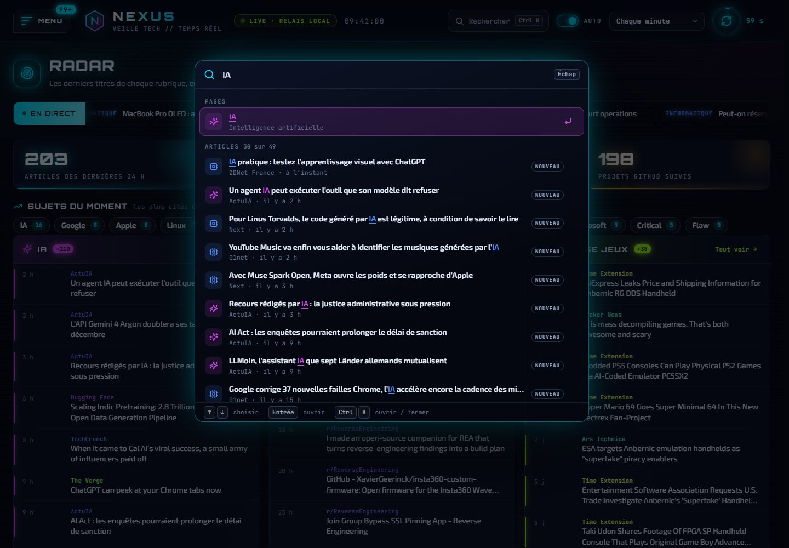<br><sub><b>Ctrl K → Rechercher partout</b> : un mot, et NEXUS trouve les articles de toutes les rubriques, les pages, les jeux, les apps, les modèles d'IA et les actions. Flèches et Entrée pour ouvrir.</sub></td>
  </tr>
  <tr>
    <td colspan="2">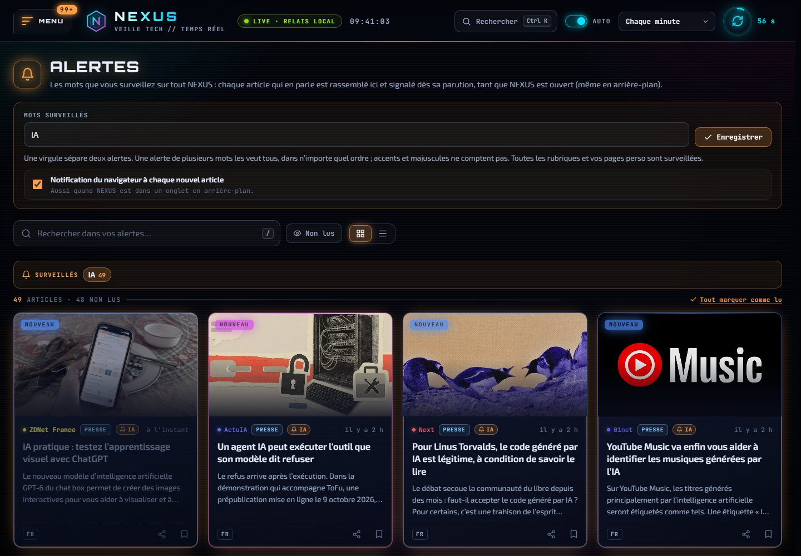<br><sub><b>Menu → Alertes</b> : les mots surveillés, les articles qui en parlent dans toutes les rubriques, et la notification du navigateur en option.</sub></td>
  </tr>
  <tr>
    <td colspan="2">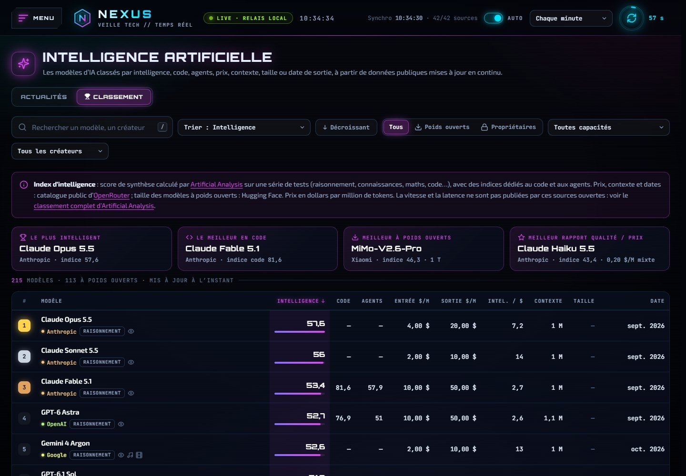<br><sub><b>IA → Classement</b> : les modèles d'IA triés par intelligence, code, agents, prix, contexte, taille ou date, avec les meilleurs de chaque catégorie en tête.</sub></td>
  </tr>
  <tr>
    <td width="50%">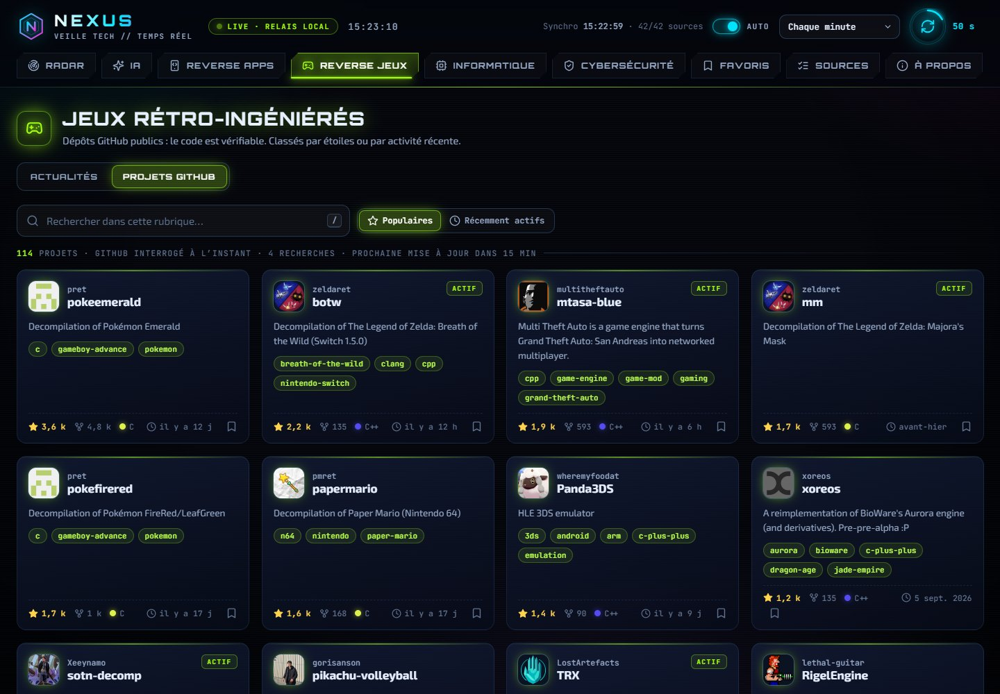<br><sub><b>Reverse Jeux → Projets GitHub</b> : Pokémon, Zelda, Castlevania… décompilés par leurs communautés.</sub></td>
    <td width="50%">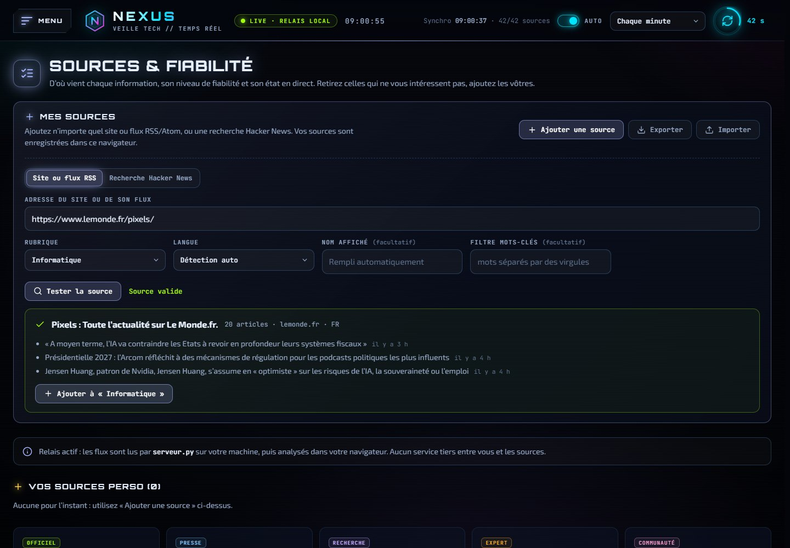<br><sub><b>Sources perso</b> : collez l'adresse d'un site, NEXUS trouve son flux et montre un aperçu.</sub></td>
  </tr>
  <tr>
    <td colspan="2">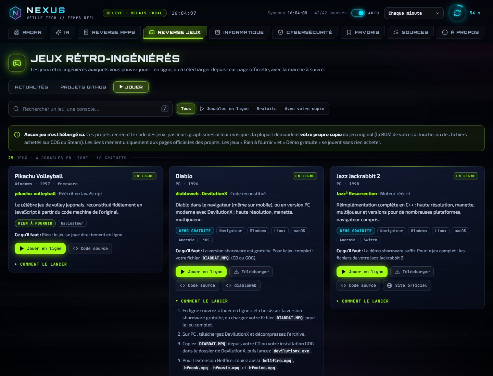<br><sub><b>Reverse Jeux → Jouer</b> : Diablo, Zelda, Tomb Raider, OpenTTD… jouables en ligne ou à télécharger, avec la marche à suivre. Aucun jeu n'est hébergé : liens officiels uniquement.</sub></td>
  </tr>
  <tr>
    <td colspan="2">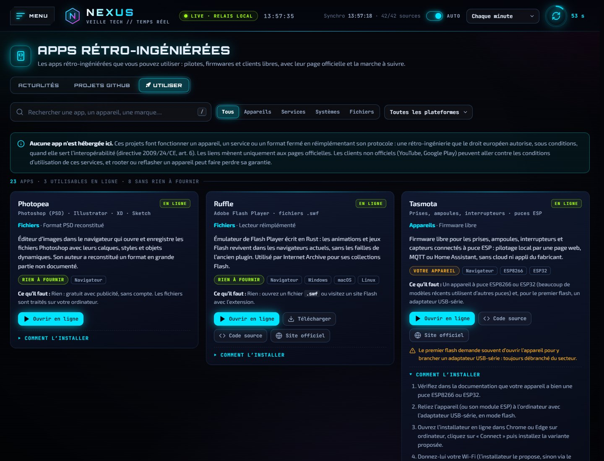<br><sub><b>Reverse Apps → Utiliser</b> : Photopea, Ruffle, Tasmota, Gadgetbridge, OpenRGB, Asahi Linux… triées par domaine (appareils, services, systèmes, fichiers) et par plateforme, avec la marche à suivre.</sub></td>
  </tr>
  <tr>
    <td colspan="2">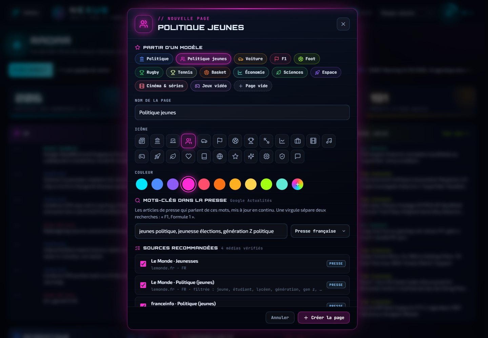<br><sub><b>Menu → Créer une page</b> : partez d'un modèle ou d'une page vide, choisissez l'icône et la couleur, suivez des mots-clés dans la presse et cochez les médias recommandés.</sub></td>
  </tr>
  <tr>
    <td colspan="2">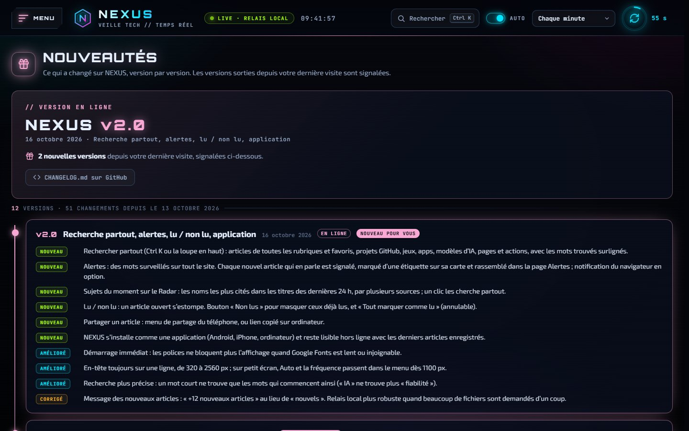<br><sub><b>Menu → Nouveautés</b> : la version en ligne et l'historique des versions. Celles sorties depuis votre dernière visite sont signalées.</sub></td>
  </tr>
</table>

## Rubriques et sources

| Rubrique | Sources |
|---|---|
| **IA** | OpenAI, Google DeepMind, Google AI, Hugging Face, MIT Technology Review, Ars Technica, The Verge, TechCrunch, Numerama, ActuIA, Simon Willison |
| **Reverse Apps** | Google Project Zero, Check Point Research, Trail of Bits, Objective-See, Hackaday, Hacker News, Lobsters, r/ReverseEngineering, GitHub |
| **Reverse Jeux** | Time Extension, Ars Technica, Hacker News, Hackaday, Lobsters (filtrés par mots-clés), GitHub |
| **Informatique** | Hacker News, Ars Technica, The Verge, LWN.net, Tom's Hardware, Next, Numerama, 01net, ZDNet France, Korben |
| **Cybersécurité** | CERT-FR (ANSSI), NCSC (Royaume-Uni), BleepingComputer, The Hacker News, ZATAZ, Krebs on Security |

Toutes les sources sont des flux RSS/Atom ou des API publiques.
Le classement des IA vient du catalogue public d'[OpenRouter](https://openrouter.ai/models), qui reprend les indices d'[Artificial Analysis](https://artificialanalysis.ai/). La taille des modèles à poids ouverts vient de [Hugging Face](https://huggingface.co/).
NEXUS affiche le titre, un court extrait et le lien de chaque article, comme un lecteur RSS. Le contenu appartient à ses auteurs.

## Démarrer

Il faut **Python 3.8 ou plus récent**. Rien d'autre à installer.

**Windows :** double-cliquez sur `lancer.bat`. Le site s'ouvre sur <http://127.0.0.1:8787/>.

**macOS / Linux :**

```bash
git clone https://github.com/PedroGomesFR/nexus.git
cd nexus
python3 serveur.py
```

Gardez la fenêtre du serveur ouverte pendant que vous consultez le site, `Ctrl+C` l'arrête.

> **Pourquoi un serveur ?** Les navigateurs interdisent à une page de lire directement les flux RSS des autres sites (CORS).
> `serveur.py` est un petit relais qui les récupère à sa place. Sans lui, `index.html` s'ouvre quand même, mais seules les sources qui autorisent la lecture directe s'affichent.

## Héberger en ligne

Le bouton **Déployer sur Render** en haut de cette page crée le service automatiquement, sur l'offre gratuite.

Vous pouvez aussi le faire à la main : sur Render, **New + → Blueprint**, choisissez ce dépôt, puis **Apply**. Le fichier `render.yaml` contient déjà toute la configuration.
Ensuite, chaque `git push` redéploie le site.

| Variable | Rôle |
|---|---|
| `PORT` | Fournie par l'hébergeur. Sa présence active le mode en ligne : écoute sur `0.0.0.0`, pas d'ouverture de navigateur. |
| `GITHUB_TOKEN` | Facultatif. Un jeton GitHub *fine-grained* **sans aucune permission** relève la limite de l'API GitHub, qui alimente les pages Projets GitHub. |
| `HOST` | Facultatif. Adresse d'écoute, pour forcer une valeur. |

Bon à savoir sur l'offre gratuite de Render : le service s'endort après 15 minutes sans visite et met environ une minute à se réveiller.
Certains sites, comme Reddit, bloquent les serveurs d'hébergement : ces sources apparaissent alors en erreur dans la page Sources.

## Personnaliser

**Dans l'interface, pour vous seul.** La page **Sources** permet de retirer une source du catalogue ou d'ajouter la vôtre.
**Menu → Créer une page** ajoute une page sur le sujet de votre choix. Elle peut combiner trois choses :

- **un modèle** : politique, politique jeunes, voiture, F1, foot, rugby, tennis, basket, économie, sciences, espace, cinéma et séries, jeux vidéo ;
- **des mots-clés** suivis dans la presse via Google Actualités, la virgule séparant deux recherches (« F1, Formule 1 ») ;
- **vos propres sites ou flux RSS**, ajoutés depuis la page avec « Ajouter une source ».

Les mots-clés valent pour toute la page : ses sites (médias du modèle, sites ajoutés) n'affichent que les articles qui contiennent
au moins un mot-clé, sans tenir compte des accents ni des majuscules. Un bandeau en haut de la page rappelle les mots-clés suivis,
compte les articles masqués et permet de tout afficher. L'option se règle aussi dans **Personnaliser**.

Le bouton **Personnaliser** de la page change ensuite son nom, son icône, sa couleur et ses mots-clés, ou la supprime.
Ces choix sont enregistrés dans votre navigateur. Pour les transférer, utilisez **Exporter** puis **Importer**.

**Dans le code, pour tout le monde.** Le catalogue se trouve dans [`js/sources.js`](js/sources.js). Une source s'écrit en une ligne :

```js
{ id: 'lwn', cat: 'info', name: 'LWN.net', site: 'https://lwn.net/', url: 'https://lwn.net/headlines/rss', type: 'presse', lang: 'en' },
```

| Champ | Description |
|---|---|
| `cat` | Rubrique : `ia`, `apps`, `jeux`, `info` ou `cyber` |
| `url` | Flux RSS/Atom ou API ; un tableau pour fusionner plusieurs requêtes |
| `kind` | `rss` (par défaut), `hn` (recherche Hacker News) ou `github` (recherche de dépôts) |
| `type` | `officiel`, `presse`, `recherche`, `expert`, `communaute` ou `projet` |
| `include` / `exclude` | Expression régulière pour filtrer les articles par mots-clés |
| `minAge` | Délai minimal entre deux requêtes, en secondes (30 par défaut) |

**Publier une version.** La version en ligne est la première entrée de [`js/changelog.js`](js/changelog.js) :
c'est elle qu'affichent le menu, le pied de page, « À propos » et la page **Nouveautés**. Pour en publier une :

1. ajoutez une entrée **en haut** de `js/changelog.js` (numéro, date, titre, changements `new` / `better` / `fix`) ;
2. reportez-la dans [`CHANGELOG.md`](CHANGELOG.md) et mettez à jour le badge de version de ce README.

À leur visite suivante, les visiteurs voient une notification et une pastille sur **Nouveautés**, une seule fois par version.

## Comment ça marche

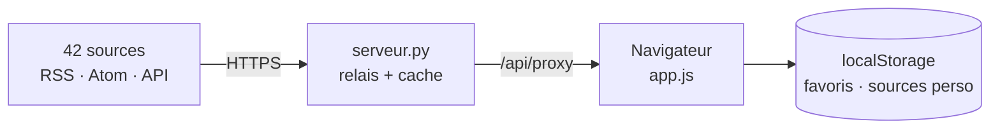

1. **Le navigateur** demande chaque flux au relais. Il le fait toutes les minutes, ou moins souvent pour les sources à quota (GitHub, Reddit).
2. **Le relais** télécharge le flux et le garde en cache de 20 secondes à 10 minutes. Il utilise des requêtes conditionnelles (ETag) pour ménager les sites.
   Il allège aussi les flux démesurés : certains contiennent le texte intégral de chaque article, jusqu'à 11 Mo. Il n'en garde que l'extrait et la première image.
3. **Le navigateur** analyse les flux, trie, filtre et affiche les articles. Rien n'est envoyé ailleurs.
   Quand un flux n'a pas changé depuis la minute précédente, le relais répond « inchangé » (304) : rien n'est retéléchargé ni réanalysé.
   En ligne, les réponses sont en plus compressées (gzip).

```
nexus/
├── index.html      la page
├── css/style.css   thème néon, mise en page, animations
├── js/sources.js   catalogue des rubriques et des sources
├── js/themes.js    modèles de pages perso (politique, F1, foot…)
├── js/games.js     jeux rétro-ingéniérés de la vue « Jouer »
├── js/apps.js      apps rétro-ingéniérées de la vue « Utiliser »
├── js/changelog.js historique des versions (page « Nouveautés »)
├── js/app.js       l'application (JavaScript pur, sans framework)
├── serveur.py      le relais (bibliothèque standard Python)
├── sw.js           service worker : application installable, lecture hors ligne
├── manifest.webmanifest  nom, icônes et couleurs de l'application installée
├── icons/          icônes de l'application
├── CHANGELOG.md    journal des versions
├── lancer.bat      démarrage en un double-clic sous Windows
├── render.yaml     configuration de déploiement Render
└── docs/           logo et captures d'écran
```

## Vie privée et sécurité

- **Aucune donnée collectée.** Pas de compte, pas de cookie de suivi, pas de statistiques. Favoris, articles lus, alertes, pages perso et réglages restent dans le `localStorage` de votre navigateur.
- **Alertes et notifications locales.** Les mots surveillés ne quittent pas votre navigateur : c'est NEXUS, ouvert dans un onglet, qui compare les nouveaux articles et affiche la notification. Aucun serveur d'envoi.
- **Hors ligne.** Le service worker garde seulement les fichiers du site (jamais les réponses du relais) et ne s'en sert que sans connexion : en ligne, la dernière version est toujours chargée.
- **Mots-clés des pages perso.** Ils sont transmis à Google Actualités par le relais, comme une recherche ordinaire, sans rien qui vous identifie.
- **Contenus tiers chargés.** Ce sont seulement les images des articles (depuis leurs sites), les polices Google Fonts et, si vous cliquez sur « Traduire », Google Traduction.
- **Un relais limité.** Il refuse les adresses du réseau local. Pour les sources perso, il ne relaie que de vrais flux RSS/Atom, avec une limite de débit une fois en ligne : il ne peut pas servir de proxy web ouvert.
- **Peu de fichiers servis.** Seuls le site et son code source sont publics. `.git` et la configuration ne le sont pas.
- **Rien n'est exécuté.** Le contenu des flux est toujours affiché comme du texte. Seuls les liens `http(s)` sont acceptés.

## Raccourcis clavier

| Touche | Action |
|---|---|
| `Ctrl K` (`⌘ K` sur Mac) | Rechercher partout ; `↑` `↓` pour choisir, `Entrée` pour ouvrir |
| `M` | Ouvrir / fermer le menu |
| `R` | Rafraîchir maintenant |
| `A` | Activer / couper le rafraîchissement automatique |
| `/` | Rechercher dans la rubrique |
| `1` … `9` | Aller à l'une des neuf premières pages du menu |

## Contribuer

Les propositions sont les bienvenues, qu'il s'agisse d'une source fiable qui manque, d'un bug ou d'une amélioration de l'interface.
Ouvrez une *issue* ou une *pull request*. Pour une nouvelle source, indiquez pourquoi elle est fiable : éditeur reconnu, équipe de recherche, publication officielle…

<br>

<div align="center">

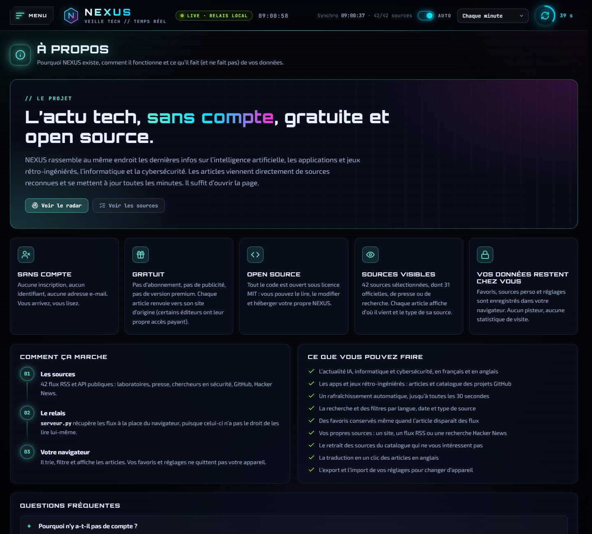

**Licence [MIT](LICENSE)** · © 2026 Pedro Gomes

Créé par **Pedro Gomes**

</div>
